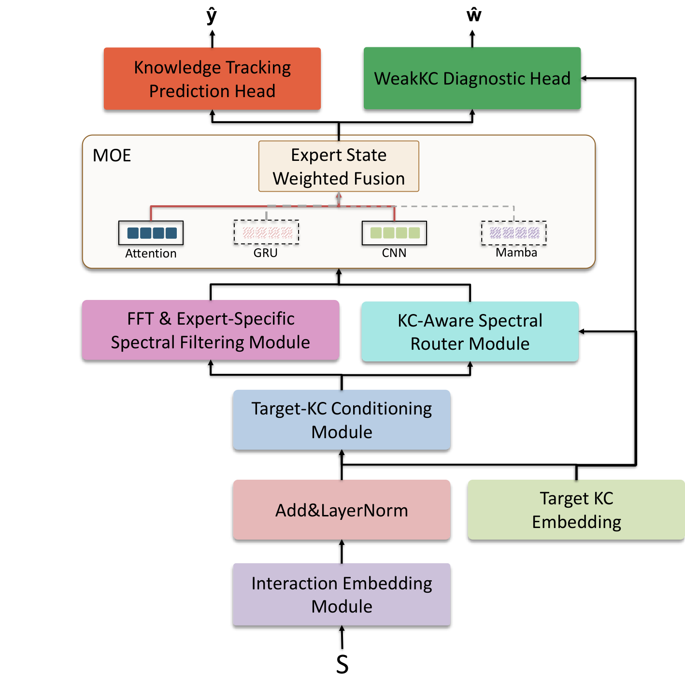
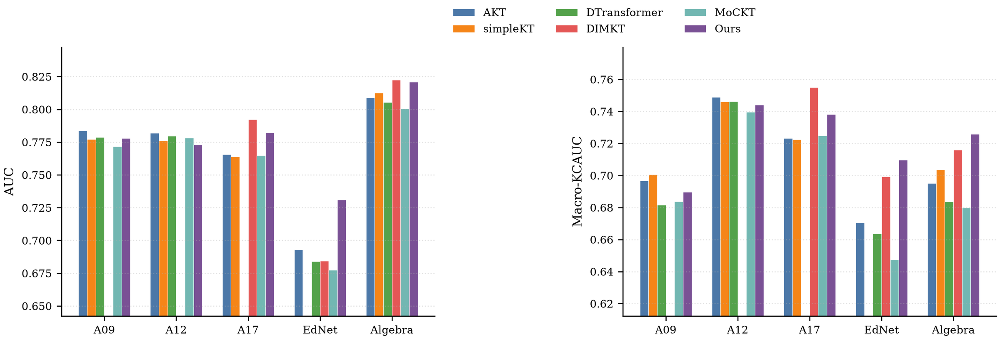
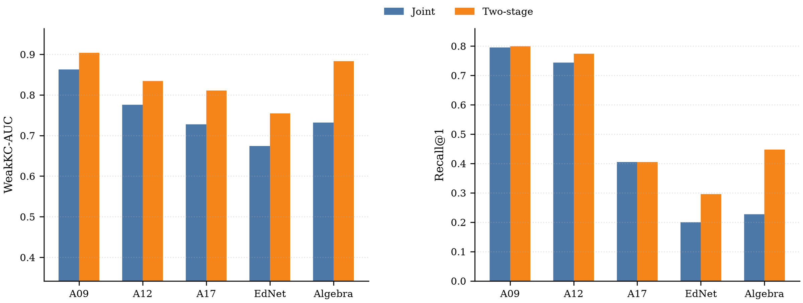

# SpectralMoE-KT

> 基于频谱混合专家的知识追踪与薄弱知识点诊断方法<br>
> Knowledge tracing and weak knowledge component diagnosis with spectral mixture-of-experts

[](https://www.python.org/)
[](https://pytorch.org/)
[](https://github.com/state-spaces/mamba)
[](docs/EXPERIMENT_GUIDE.md)

SpectralMoE-KT 面向两项相关任务：根据严格历史前缀预测下一次作答正确率，以及估计学生未来在原子知识点上的薄弱风险。模型将目标知识点条件化、可学习复数频谱滤波和异构专家路由组合在同一框架中，并在五个公开数据集上采用统一的学生集合划分和双随机种子协议进行评估。

<p align="center">
  
</p>

## 核心设计

- **原子 KC 表示**：多知识点题目采用掩码平均嵌入，不把知识点集合编码成新的类别。
- **目标 KC 条件化**：同一学生针对不同目标知识点生成差异化历史状态。
- **专家专属频谱滤波**：在严格历史前缀上执行 RFFT，并用四组可学习复数滤波器生成专家输入。
- **异构专家池**：Attention、GRU、CNN 与官方 `mamba_ssm.Mamba` 提供互补的序列表示。
- **Top-2 稀疏路由**：结合历史池化、频谱统计和目标 KC 嵌入动态融合两个专家。
- **双任务输出**：同时支持下一题预测和 WeakKC 薄弱知识点风险排序，并提供联合训练与两阶段训练。

## 实验概览

实验覆盖 ASSISTments 2009/2012/2017、EdNet 和 Algebra I 2005–2006。所有正式结果使用学生互斥的约 8:1:1 划分、fold 0、非滑动测试、随机种子 3407/2026，并报告两次运行的算术均值。

| 数据集 | AUC | ACC | RMSE ↓ | Macro-KCAUC |
|---|---:|---:|---:|---:|
| ASSISTments 2009 | 0.7778 | 0.7355 | 0.4225 | 0.6896 |
| ASSISTments 2012 | 0.7730 | 0.7542 | 0.4096 | 0.7440 |
| ASSISTments 2017 | 0.7821 | 0.7268 | 0.4242 | 0.7383 |
| EdNet | **0.7309** | **0.7033** | **0.4410** | **0.7097** |
| Algebra I 2005–2006 | 0.8208 | 0.8221 | 0.3572 | 0.7259 |

<p align="center">
  
</p>

两阶段训练保持第一阶段的 KT 表示并单独优化诊断头，在五个数据集上均提高了 WeakKC-AUC。完整数值、Recall@K、消融与路由结果见 [实验结果汇总](RESULTS.md) 和 [`results/tables/`](results/tables/)。

<p align="center">
  
</p>

## 快速开始

```bash
git clone https://github.com/Qinghe9/KT.git
cd KT

conda create -n spectralmoe python=3.10 -y
conda activate spectralmoe
pip install -r requirements.txt

# 数据完整性与因果约束测试
python -m unittest discover -s tests -v

# 单数据集训练示例；data/atomic_fold0/assist2009 需先按指南生成
python train.py \
  --fold-data --fold 0 \
  --data data/atomic_fold0/assist2009 \
  --out runs/quickstart/assist2009 \
  --epochs 100 --patience 10 --min-delta 0.001 \
  --scheduler-patience 3 --lr-factor 0.5 --min-lr 1e-6 \
  --batch 2048 --workers 2 --amp \
  --dim 32 --context 200 --topk 2 --lr 0.003 --seed 3407 \
  --lambda-weak 0.2 --lambda-balance 0.01 \
  --weak-history-ratio 0.7 --weak-min-history 16 --weak-min-future 10 \
  --weak-positive-threshold 0.6 --weak-negative-threshold 0.4 \
  --device cuda:0 --test
```

从原始数据准备、双 GPU 正式训练、两阶段训练、消融实验到结果核验的完整命令见 **[实验复现指南](docs/EXPERIMENT_GUIDE.md)**。

## 仓库结构

```text
KT/
├── model.py                 # SpectralMoE-KT、四类专家与路由器
├── train.py                 # 训练、验证、早停、测试与预测导出
├── data.py                  # 学生序列、原子 KC 与严格历史前缀
├── weakkc.py                # WeakKC 标签、诊断头与 Recall@K
├── canonical_*.py           # 统一评估数据集与协议
├── diagnose.py              # 单学生薄弱知识点诊断入口
├── docs/
│   ├── EXPERIMENT_GUIDE.md  # 端到端复现实验指南
│   └── assets/              # 架构图和论文实验图
├── results/tables/          # 当前论文使用的权威结果表
├── scripts/
│   ├── experiments/         # 可移植的正式实验入口
│   └── analysis/            # 汇总、审计与导出工具
├── tests/                   # 因果性、路由和结构完整性测试
└── reproduction/            # 统一评估审计与归档结果
```

## 结果与数据约定

- `data/`、`runs/`、模型权重、逐交互预测和日志不提交 Git；它们由复现指南在本地生成。
- `results/tables/` 是 README 与论文图表的权威汇总源，不应手工改写数值。
- WeakKC 标签由诊断时点之后的同一 KC 作答统计生成；未来记录只生成监督标签，不进入历史编码。
- Recall@K 是学生候选 KC 集合上的宏平均风险召回，不等价于题库推荐 Recall@K。

## 文档

- [完整实验指南](docs/EXPERIMENT_GUIDE.md)
- [结果说明](RESULTS.md)
- [Algebra 统一实验协议](reproduction/canonical_weakkc_algebra2005/实验协议说明.md)

## 引用

若本项目对你的研究有帮助，请在正式论文发布后使用论文给出的 BibTeX。在此之前，可引用本仓库并注明固定 Git commit，以保证代码版本可追溯。
