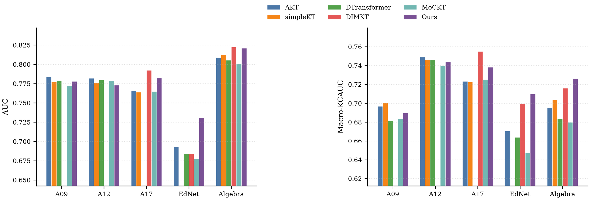
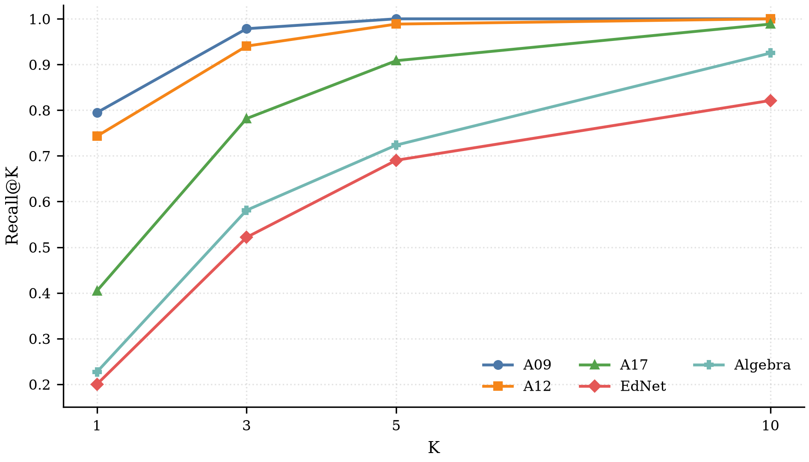
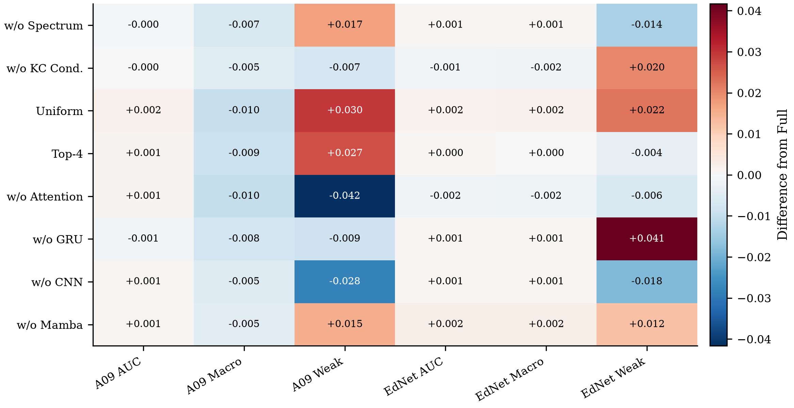
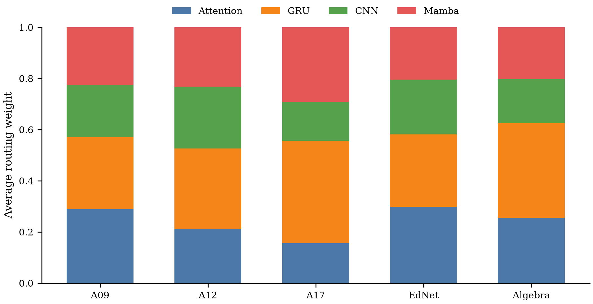

# 实验结果

本页只概述主要结论。论文表格使用的完整精度结果保存在 [`results/tables/`](results/tables/)；其中 `main_results_two_seed_unified.csv` 含统一协议下的逐模型汇总，其他 CSV 对应论文表 5-1 至表 6-7。

## 协议

- 数据集：ASSISTments 2009、ASSISTments 2012、ASSISTments 2017、EdNet、Algebra I 2005–2006
- 划分：学生集合互斥的约 8:1:1，固定 fold 0，划分种子 1024
- 评估：非滑动窗口，严格历史前缀，原子 KC
- 运行：训练随机种子 3407 和 2026，表中报告算术均值
- KT 指标：AUC、ACC、RMSE、Macro-KCAUC
- 诊断指标：WeakKC-AUC、Recall@1/3/5/10

## 本模型的知识追踪结果

| 数据集 | AUC | ACC | RMSE ↓ | Macro-KCAUC |
|---|---:|---:|---:|---:|
| ASSISTments 2009 | 0.7778 | 0.7355 | 0.4225 | 0.6896 |
| ASSISTments 2012 | 0.7730 | 0.7542 | 0.4096 | 0.7440 |
| ASSISTments 2017 | 0.7821 | 0.7268 | 0.4242 | 0.7383 |
| EdNet | 0.7309 | 0.7033 | 0.4410 | 0.7097 |
| Algebra I 2005–2006 | 0.8208 | 0.8221 | 0.3572 | 0.7259 |

## 薄弱知识点诊断

### 联合训练

| 数据集 | WeakKC-AUC | Recall@1 | Recall@3 | Recall@5 | Recall@10 |
|---|---:|---:|---:|---:|---:|
| ASSISTments 2009 | 0.8625 | 0.7948 | 0.9784 | 1.0000 | 1.0000 |
| ASSISTments 2012 | 0.7758 | 0.7431 | 0.9403 | 0.9885 | 1.0000 |
| ASSISTments 2017 | 0.7273 | 0.4044 | 0.7817 | 0.9084 | 0.9885 |
| EdNet | 0.6742 | 0.2000 | 0.5217 | 0.6904 | 0.8212 |
| Algebra I 2005–2006 | 0.7322 | 0.2269 | 0.5810 | 0.7236 | 0.9250 |

### 联合训练与两阶段训练

| 数据集 | Joint WeakKC-AUC | Two-stage WeakKC-AUC | Joint Recall@1 | Two-stage Recall@1 |
|---|---:|---:|---:|---:|
| ASSISTments 2009 | 0.8625 | 0.9034 | 0.7948 | 0.7994 |
| ASSISTments 2012 | 0.7758 | 0.8345 | 0.7431 | 0.7741 |
| ASSISTments 2017 | 0.7273 | 0.8107 | 0.4044 | 0.4052 |
| EdNet | 0.6742 | 0.7543 | 0.2000 | 0.2958 |
| Algebra I 2005–2006 | 0.7322 | 0.8832 | 0.2269 | 0.4477 |

两阶段训练在五个数据集上均取得更高的 WeakKC-AUC；它复用第一阶段 KT 检查点并冻结编码主体，只优化 WeakKC 诊断头。

## 消融与路由

消融实验在 ASSISTments 2009 和 EdNet 上执行。热力图数值为“变体指标 − 完整模型指标”，因此正负号只表示相对变化，不代表所有组件在所有任务上的单调贡献。

平均路由权重显示不同数据集采用了不同的专家分配；这是数据集层面的汇总，逐样本仍由 Top-2 路由动态选择。

## 文件索引

| 文件 | 内容 |
|---|---|
| `main_results_two_seed_unified.csv` | 统一协议下全部模型、全部指标 |
| `table5_1_kt.csv` | 主文 KT 对比 |
| `table5_2_weakkc.csv` | WeakKC-AUC 对比 |
| `table5_3_recall.csv` | 本模型 Recall@K |
| `table5_4_training_modes_verified.csv` | KT-only、联合、两阶段训练 |
| `table6_1_ablation_deltas.csv` | 消融相对完整模型的差值 |
| `table6_7_routing.csv` | 四类专家的平均路由权重 |
